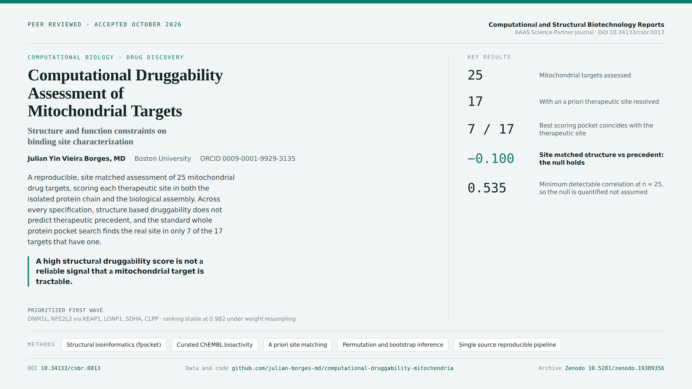

<div align="center">



# Computational Druggability Assessment of Mitochondrial Targets

### Structure-Function Constraints and Binding Site Characterization

Julian Yin Vieira Borges, MD &nbsp;&middot;&nbsp; Boston University &nbsp;&middot;&nbsp; ORCID [0009-0001-9929-3135](https://orcid.org/0009-0001-9929-3135)

[](https://doi.org/10.34133/csbr.0013)
[](https://doi.org/10.5281/zenodo.19389356)
[](LICENSE)
[](https://creativecommons.org/licenses/by/4.0/)
[](https://www.python.org/)


</div>

---

Code and data to reproduce the analyses in the peer reviewed article:

> Borges JYV. **Computational Druggability Assessment of Mitochondrial Targets: Structure-Function Constraints and Binding Site Characterization.** *Computational and Structural Biotechnology Reports* (AAAS Science Partner Journal), 2026. DOI [10.34133/csbr.0013](https://doi.org/10.34133/csbr.0013).

Archived dataset, version of record: Zenodo concept DOI [10.5281/zenodo.19389356](https://doi.org/10.5281/zenodo.19389356).

## Summary

This repository assesses the druggability of 25 mitochondrial targets with a reproducible, multi dimensional pipeline. The structural dimension is scored at a therapeutic site defined in advance, in both the isolated protein chain and the biological assembly, rather than at whichever pocket scores highest anywhere on the protein. Bioactivity evidence, therapeutic precedent, and structure quality are integrated, and inference uses permutation and bootstrap methods with a stated minimum detectable effect size.

## Key result

The central finding is a carefully established null. Structure based druggability at the therapeutic site does not predict therapeutic precedent or target priority under any specification: site matched structure versus precedent is +0.117 in the isolated chain and -0.100 in the biological assembly, tier versus site matched pocket druggability is -0.037 (permutation p = 0.93), and tier versus composite is -0.709. The highest scoring pocket from naive whole protein scoring coincides with the a priori therapeutic site in only 7 of the 17 targets that have a resolved site. A strong structural druggability score computed the usual way is therefore not a reliable signal that a mitochondrial target is tractable, and it often points to the wrong location on the protein.

## Key numbers at a glance

| Quantity | Value |
|---|---|
| Mitochondrial targets assessed | 25 |
| Targets with an a priori therapeutic site resolved | 17 |
| Best scoring whole protein pocket coincides with that site | 7 of 17 |
| Site matched structure vs precedent, isolated chain (Spearman) | +0.117 |
| Site matched structure vs precedent, biological assembly (Spearman) | -0.100 |
| Tier vs site matched pocket druggability | -0.037 (permutation p = 0.93) |
| Tier vs composite priority | -0.709 |
| Minimum detectable correlation at n = 25, 80 percent power | 0.535 |
| Composite ranking stability under weight resampling | 0.982 |

## Repository layout

| Path | Contents |
|---|---|
| `data/` | The single source matrix (`matrix_v13.csv`), the per target registry (`druggability_registry_v1.3.yaml`), the supplementary tables S1 to S8 (workbook plus per table CSVs), and the underlying outputs every reported number derives from (`final_stats.json`, `derived_stats.json`, `site_scores_final.csv`, `weight_sensitivity.json`, `af_confidence.csv`, and others) |
| `scripts/` | The reproduction and verification pipeline, including `purestats.py` (rank correlations and resampling using the Python standard library only), the `build_*.py` generators, and the retrieval scripts that document how external inputs were produced |
| `docs/` | Provenance notes carried from the Zenodo deposit (metadata and deposit instructions) and the graphical summary |

## Reproduce

Requirements: Python 3. The core statistics depend on the standard library only, through `scripts/purestats.py`. The table and document build steps use `openpyxl` and `python-docx`; these are not needed for the statistics.

```bash
python3 scripts/final_stats.py
python3 scripts/derived_stats.py
python3 scripts/build_tables.py
python3 scripts/preflight.py      # must print PASSED
```

Every reported statistic is generated from `data/matrix_v13.csv` and verified by `scripts/preflight.py`, which recomputes the statistics from that matrix and fails on any drift. This single source discipline is what keeps the manuscript, the registry, the tables, and the supplementary workbook in agreement.

External inputs, pocket detection with fpocket, bioactivity from ChEMBL, and structure confidence from AlphaFold (pLDDT and PAE), were produced upstream and their processed results are included under `data/`, so the analysis reproduces without rerunning those external tools. The retrieval scripts (`chembl_query.py`, `fpocket_pipeline.py`, `download_struct.py`, `fetch_uniprot_sites.py`) document how those inputs were generated.

## Methods, in brief

The therapeutic site for each target is defined a priori, before any pocket comparison. Structural druggability is scored at that site in the isolated chain and in the biological assembly. The composite is fully specified and its weights are tested with a Monte Carlo; the ranking is stable, with a rank correlation of 0.982 across perturbations. Inference uses permutation tests and percentile bootstrap intervals, and the minimum detectable correlation at n = 25 and 80 percent power is 0.535, so the null is reported as a null rather than as proof of absence. A defensible first wave for follow up is identified (DNM1L, the NFE2L2 and KEAP1 axis, LONP1, SDHA, and CLPP), with the uncertainty stated explicitly.

## Intended use and limitations

This is a computational prioritization and methodology study, not an experimental validation. The null concerns structure only druggability scored at the therapeutic site; it does not claim that mitochondrial targets are undruggable, only that a high structural score computed the usual way is not a reliable signal of tractability. The sample is the 25 targets specified in the study, and the analysis is powered to detect correlations at or above 0.535; smaller true effects cannot be excluded. The first wave is a prioritization under stated uncertainty and is intended to direct experimental follow up, not to replace it.

## Restricted data

Four novel virtual hits (`MITO_CPD_0121` to `MITO_CPD_0124`) are under a pending non provisional patent filing. In this public repository their records are withheld in full: the SMILES, canonical SMILES, and InChIKey carry a restriction notice, and the PubChem identifier, molecular formula and weight, target assignment, and descriptive name are withheld as well. Only the compound id and the category (virtual hit) remain. The complete records are held in a restricted archive and are available on reasonable request to the corresponding author. All other compounds in the library are fully disclosed.

## License

Code is released under the MIT License (see [`LICENSE`](LICENSE)). Data are released under the Creative Commons Attribution 4.0 International license (CC BY 4.0), consistent with the Zenodo deposit.

## Citation

If you use this code or data, please cite the article (DOI 10.34133/csbr.0013) and the archived dataset (Zenodo 10.5281/zenodo.19389356). A machine readable citation is in [`CITATION.cff`](CITATION.cff).

## Author

Julian Yin Vieira Borges, MD. ORCID [0009-0001-9929-3135](https://orcid.org/0009-0001-9929-3135).

---

<div align="center">

**Julian Yin Vieira Borges, MD** &nbsp;&middot;&nbsp; Physician-Scientist &nbsp;&middot;&nbsp; Clinical AI Governance and Translational Research

[](https://julian-borges-md.github.io/research-profile/)
[](https://orcid.org/0009-0001-9929-3135)
[](https://www.bu.edu/)
[](https://gcsrt.hms.harvard.edu/)

</div>
